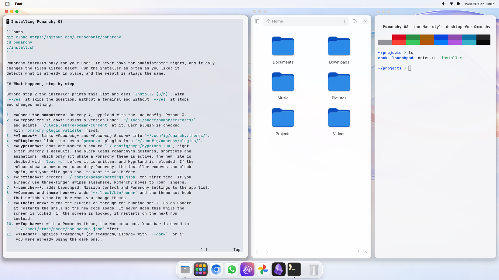

# Pomarchy

The light theme of [Pomarchy OS](https://github.com/BrunooMoniz/pomarchy), a Mac-style desktop for Omarchy 4.



```bash
omarchy theme install https://github.com/BrunooMoniz/omarchy-pomarchy-theme
```

This theme brings the colors, the wallpapers and the look of the Omarchy shell.
The Dock, Launchpad, Mission Control, window buttons and the Mac menu bar come
with Pomarchy OS itself:

```bash
git clone https://github.com/BrunooMoniz/pomarchy
cd pomarchy
./install.sh
```

If you install Pomarchy OS later, its installer moves this folder to
`~/.local/state/pomar/backup/` and links its own copy of the theme in its
place, so both stay the same theme.

Made for Pomarchy OS. The files here are generated from the
[Pomarchy repository](https://github.com/BrunooMoniz/pomarchy/tree/main/themes/pomarchy); send changes there.

## Em português

O tema claro do [Pomarchy OS](https://github.com/BrunooMoniz/pomarchy), o Omarchy 4 com jeito de Mac.

```bash
omarchy theme install https://github.com/BrunooMoniz/omarchy-pomarchy-theme
```

Sozinho, ele traz as cores, os papéis de parede e o visual do shell do Omarchy.
O Dock, o Launchpad, o Mission Control, os botões nas janelas e a barra de menus
do Mac vêm com o Pomarchy OS: veja o [repositório](https://github.com/BrunooMoniz/pomarchy). Se você instalar o
Pomarchy OS depois, o instalador guarda esta pasta em
`~/.local/state/pomar/backup/` e põe a cópia dele do tema no lugar.

MIT © 2026 Bruno Moniz
